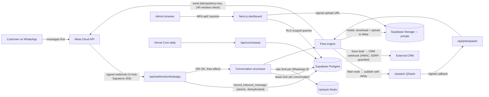
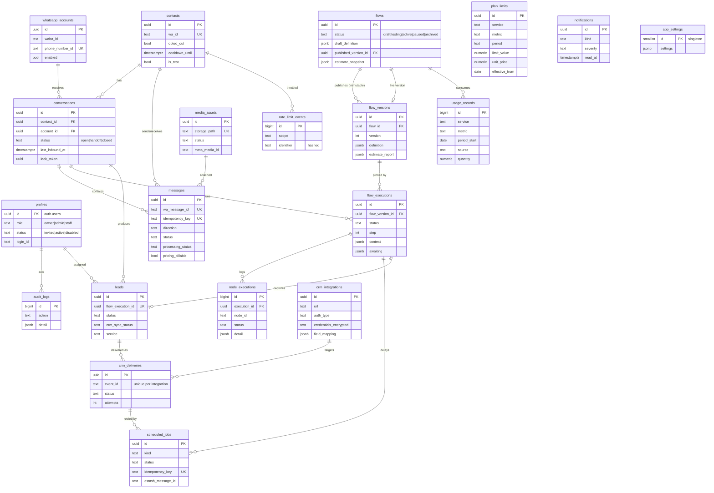

# Architecture

## System overview



**Design principles**

- **Customer-initiated only.** The engine only ever starts from a stored inbound message (`startExecution`) or resumes an execution that a customer started. There is no outbound trigger, template sender or campaign code. Every send checks the 24-hour window right before it happens, including sends that resume from QStash.
- **Ports and adapters.** `lib/engine` and `lib/core` are pure TypeScript and talk to the outside world through `EngineStore`, `MessageSender`, `Scheduler` and `CrmDispatcher`. Production wires in Supabase, Meta, QStash and HTTP adapters. The editor's simulator and the tests use the `MemoryStore` and recording fakes, so the same engine code is exercised everywhere.
- **Durable first, fast acknowledgement.** The webhook verifies the signature, records the event in a single transaction (the unique `wa_message_id` deduplicates Meta retries), returns 200, and processes the conversation afterwards. If recording fails, the response is non-2xx so Meta retries.

## Message flow

```mermaid
sequenceDiagram
  autonumber
  participant Cu as Customer
  participant Me as Meta
  participant Wh as Webhook
  participant Db as Postgres
  participant En as Engine
  participant Qs as QStash
  Cu->>Me: "Hi"
  Me->>Wh: POST event (signed)
  Wh->>Wh: verify HMAC over raw body
  Wh->>Db: record_inbound_message (contact, conversation, last_inbound_at, message)
  Wh-->>Me: 200 OK
  Wh->>Db: acquire_conversation_lock
  Wh->>En: no active execution → select trigger → startExecution
  En->>Db: claim_outbound_message (idempotency key)
  En->>Me: Welcome text
  En->>Me: Brochure (media id; skipped within 24h cooldown)
  En->>Db: scheduled_jobs row
  En->>Qs: publish {jobId}, delay 5s, deduplicationId = jobId
  Wh->>Db: release lock (re-check for pending messages)
  Qs->>En: POST /api/jobs/qstash (signed) ~5s later
  En->>Db: claim_scheduled_job (once only)
  En->>En: flow active? window open? → resumeAfterDelay
  En->>Me: "May I know your name, please?"
  Cu->>Me: "Asha"
  Me->>Wh: event
  Wh->>En: resumeWithInput → validate → interactive list
  Note over En: invalid answer → error message and re-ask (max 3) → handoff
  En->>Db: Save lead (incomplete → qualified)
  En->>CRM: POST lead.submitted (event_id, HMAC); on failure QStash retry with backoff
  En->>Me: Confirmation
```

## Concurrency and idempotency

| Risk | Mechanism |
|---|---|
| Meta delivers the same webhook twice | `messages.wa_message_id` unique; the duplicate insert is a no-op |
| Two quick messages from one customer | Per-conversation lease lock (`acquire_conversation_lock`), plus processing pending messages in provider-timestamp order, plus a re-check after release |
| Two flows starting for one conversation | Partial unique index: one active execution per conversation |
| HTTP retry re-sends a reply | `messages.idempotency_key = execution:step:node` claimed before calling Meta |
| QStash delivers a job twice | `claim_scheduled_job` moves `scheduled → running` atomically; a second delivery skips |
| Customer replies during a delay | Recorded and marked `received_during_delay`; the flow doesn't advance until the job fires |
| Flow paused while jobs are pending | Jobs cancelled in the database and in QStash, executions parked as `paused`, and the status re-checked when the job runs |
| Usage budget exhausted | Non-essential waits continue immediately and CRM retries are deferred. Inbound messages are always recorded |
| Crashed function | Locks expire after 60 s, and the daily sweep replays stranded messages, late jobs and deferred CRM deliveries |

## Security model

- **Authentication**: login with an email or login ID, rate-limited per IP and per account. A TOTP QR code is shown once at enrollment; every later sign-in asks only for the 6-digit code. Attempts are rate-limited.
- **Authorisation**: `requireAdmin()` in every server action and route handler, and `requirePageSession()` in every page, both require an **aal2** session, an active profile and the right role (owner, admin or staff).
  **RLS**: every table has RLS with a *restrictive* `aal2` policy plus role helpers. Server-only RPCs are revoked from `anon` and `authenticated`. CRM secret columns can't be selected by the browser.
- **Secrets**: CRM credentials are encrypted with AES-256-GCM (`APP_ENCRYPTION_KEY`). The WhatsApp token is stored only as a server environment variable. Logs scrub keys that look like secrets.
- **Webhooks**: Meta requests are checked with HMAC-SHA256 over the raw body, compared in constant time. QStash requests are checked with JWT signatures (current and next key). The cron endpoint requires a bearer secret.
- **Outbound CRM**: HTTPS only in production. Private, loopback, link-local and metadata IPs are rejected, both at DNS lookup and again when the connection opens (which defeats DNS rebinding). Redirects aren't followed, requests time out after 10 s, and responses are size-capped.
- **Privacy**: `robots.txt` disallows everything, every page carries `noindex, nofollow` and `X-Robots-Tag`, frames are denied, and the referrer is withheld. Media storage is private, previews use 60-second signed URLs, and there are no AI or analytics services. Configurable retention redacts message text and deletes old logs.

## Usage estimator

`lib/estimator/analyze.ts` turns the flow graph into a DAG, dropping loop edges. It then walks it in two directions:

- **Typical case (forward pass)**: probability mass spreads through the graph. Condition branches split 50/50, each question loses `completionRate^(1/questions)` of customers, and validation retries are expected values based on the configured invalid-answer rate.
- **Worst case (backward pass)**: for each resource, the most expensive branch is followed, with every QStash retry and every CRM retry counted.

Only **Wait** steps (and CRM retries in the worst case) count as QStash deliveries. Immediate steps cost nothing. Each quota is compared over its own period (QStash per day, Redis per month, storage in total). Other active flows' published snapshots are subtracted from the shared allowance. Warning bands: <70% normal, 70–84 info, 85–94 high, 95–99 critical, ≥100 exceeded.

## Entity-relationship diagram


